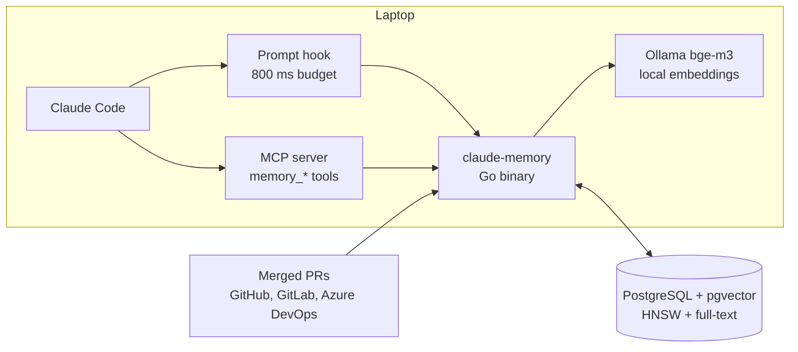

## The problem

An AI coding assistant forgets everything between sessions. Each new session rediscovers the
same conventions, the same gotchas and the same decisions, and on a team every person's assistant
learns them separately. Most memory tools solve this by recording everything, which turns into a
pile of stale, duplicated notes that nobody curates.

claude-memory is built around the opposite idea: a small, curated set of facts (patterns,
decisions, gotchas, conventions), shared across machines or people on your own Postgres, and
kept honest as the code changes.

## How it works

Claude reads and writes memory through seven MCP tools. Separately, a synchronous hook runs on
every prompt and injects up to three short "possibly relevant" memory cards, within an 800 ms
budget so it never slows the session noticeably. Knowledge comes from three places: Claude
itself during work, finished sessions, and merged pull requests.

Embeddings are computed locally by Ollama. Session transcripts and PR text go to the model only
through the user's own logged-in Claude CLI, after pattern-based secret scrubbing.

## Decisions worth explaining

### A lifecycle instead of an append-only log

New facts start as candidates and become active when they are seen again, marked useful, or
approved in a terminal review pass. Every write is compared against its nearest neighbours:
below 0.65 cosine similarity it is added, between 0.65 and 0.85 the decision goes back to the
caller instead of being stored, and above that it becomes an update or a no-op. Replaced facts
are deprecated with a pointer to their successor, and unreviewed candidates expire after 180
days.

### Strict namespaces

Every record belongs to a namespace resolved from the project directory. Search covers the
current namespace plus a global one, while deduplication, listing and lookups by ID never cross
namespaces. Nothing is written to the global namespace automatically, so one project's habits
don't leak into another.

### Staleness checked against git

A record remembers the files it is about and the commit it was written at. When it is returned
inside that repository and those files have changed since, the card says so, with the number of
commits. The assistant gets the fact and a reason to double-check it.

### Pull requests as a source of truth

Merged PRs are turned into records with at most two calls to a small model per PR, with the
merge commit as the staleness baseline. Only trusted authors count (repository members and
collaborators on GitHub, Developer and above on GitLab, no bots).

### Retrieval that is measured

Search is hybrid: vector similarity and PostgreSQL full-text, fused with Reciprocal Rank Fusion.
An eval harness reports hit@3, how many unrelated queries stay below the hook's threshold, and
the derived thresholds, and the report is tracked in git. The latest run passes every case, but
the README says plainly that the set is small and hand-written, so it is a regression test, not a
benchmark, and that some margins are thin.

### Setup that can be re-run safely

`install` records everything it writes in a manifest, backs up and merges `settings.json`, never
overwrites edited files without asking, and has a dry-run mode. `doctor` is a read-only health
check that prints a fix for every failing check.

## Why I like this project

It is honest about where it fits. The README compares it with simpler alternatives and says when
not to use it: if you work alone and want zero setup, there are easier tools. It makes sense when
you want memory shared, curated and grounded in your repository's history.
