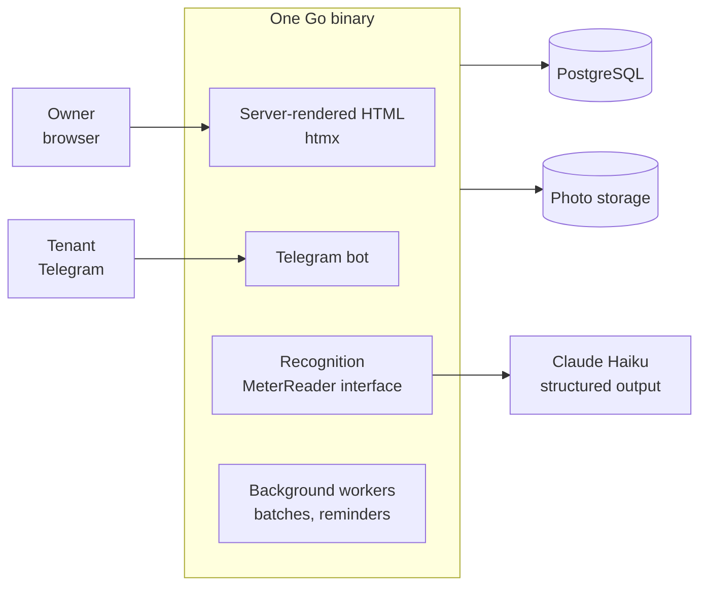

## The problem

If you rent out a flat in Ukraine, every month you collect meter readings, apply tariffs that
change over time, add fixed payments and rent, send the tenant a bill and track what they have
paid. Most people do it in a spreadsheet and a chat thread. It is tedious and easy to get wrong,
and it gets worse with every extra property.

*Komirne* is an old Ukrainian word for rent. The app turns that monthly routine into a short
to-do list per property: collect readings, review and lock the bill, remind the tenant, record
the payment, close the month.

## What it does

- **Photos instead of typing.** Take a photo of a meter, or upload a whole month's photos at
  once (up to 40, including handwritten notes and receipts). Each photo is recognised and the
  reading is offered for confirmation, along with the photo, a confidence score and any warnings.
- **Tariffs with history.** City-wide tariffs with per-flat overrides, day and night zones, and
  price changes stored as new dated records, so old bills never shift.
- **Locked bills.** A draft bill is recalculated from current data. Once locked, its lines
  (tariff, volume, amount) are stored as a snapshot that a database trigger keeps immutable.
- **Tenants in the loop.** Tenants get a link to their bill with cropped photos of each meter,
  and a Telegram bot lets them send photos and check their balance.

## Architecture

One Go binary serves the web UI, runs the bot and the background workers, and sits behind Caddy.
The UI is server-rendered HTML with htmx, without a separate frontend build.

## Decisions worth explaining

### The model never sees the expected answer

When recognising a meter, the model gets the photo and nothing else: not the previous reading,
not the registered serial number. It returns strict JSON (value, confidence, serial, photo
problems, and the bounding box of the register). All the checks run in the application: a
reading lower than last month's, an implausible jump, a different serial, low confidence. This
keeps the model from "seeing" what it is expected to read, and keeps the validation logic
testable.

### Matching photos to meters is a pure function

In a batch upload, deciding which photo belongs to which meter is done by the application, not
the model. It is a pure, tested function that tries the signals in a fixed order: the user's own
choice, the serial number, the model's guess if its value is plausible, the only meter for that
service, words in the label ("kitchen"), and finally the only meter for which the value makes
sense relative to the previous reading. Conflicts and unmatched photos go to a review screen
rather than being guessed.

### Limits that match how people actually use it

Every recognition is a paid API call and is recorded, so usage is counted from the same table.
Re-uploading the same photo reuses the stored result (matched by SHA-256). Plans have monthly,
not daily, limits, because almost all photos arrive in the few days around the turn of the month.
A per-instance hourly safety limit protects against bugs and abuse, but batch photos above it
are queued rather than rejected, and picked up automatically a couple of minutes later.

### Designed for the turn-of-the-month spike

Tenant reminders are spread over eight hours instead of firing at once. Bot messages are paced
to roughly 25 per second, honour Telegram's `retry_after`, and do not retry when the bot has been
blocked. Photos are downscaled as soon as they are uploaded, and concurrency for decoding and
recognition is capped across all batches. The dashboard loads a whole account in a fixed number
of queries rather than several per property.

### Measured, not guessed

An evaluation script runs the recogniser against a folder of real, labelled meter photos and
prints the expected and actual value for each. Prompt or model changes are checked by
measurement. The recogniser sits behind a `MeterReader` interface, so a local vision model can
be swapped in without touching the rest of the code, and tests use a fake.

## Smaller details I'm happy with

- HEIC photos from iPhones are converted with a pure-Go decoder, so the binary still has no CGo.
- Photos are stored at messenger-like sizes (a 3–5 MB original becomes about 0.5 MB), while the
  capture date is read from the original's EXIF before compression.
- Privacy, terms and account-deletion pages were written against what the code actually does:
  retention periods, data processors and who controls tenant data.

The code is private. I'm happy to walk through it on a call.
