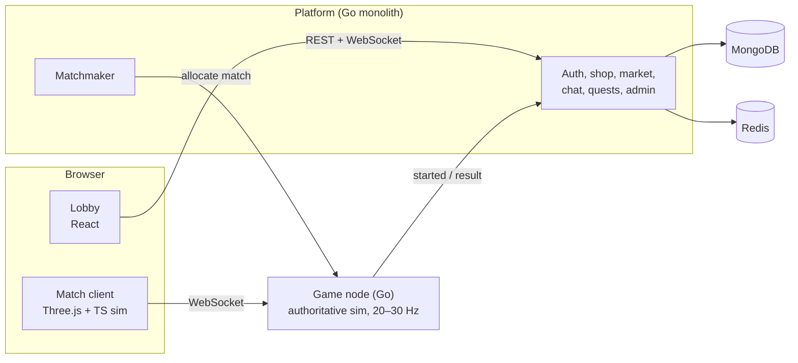

## What it is

A blocky, voxel-style FPS you play in a browser tab, no install. Players sign in, queue from a
lobby, get placed into a match on a game server, and earn currency, items and quest progress
that carry over between matches. Around the match there is a whole platform: a shop,
inventory, a player-to-player market, chat, friends, quests, premium status, moderation tools
and an admin panel.

The voxel look is a deliberate engineering choice as much as a style. Box geometry keeps
collision simple and cheap to run on both server and client, and makes characters, maps and
skins easy to produce without an art team.

## Architecture

The system is split into two planes. The **platform** owns everything persistent: accounts,
economy, inventory, social features. The **game plane** runs matches and never touches a
database during play. Each match is a goroutine on a game node running a fixed tick loop.

## Decisions worth explaining

### The same simulation, written twice

Movement and collision exist in Go on the server (the authority) and in TypeScript on the
client (for prediction). If the two disagree even slightly, players see rubber-banding on every
input. Both versions are small pure modules with no rendering, networking or clocks inside, and
a shared suite of JSON test vectors (initial state plus inputs, mapped to the expected state)
runs against both languages in CI. If they diverge, the build fails. That suite is the contract
between the two implementations.

### Prediction, reconciliation and lag compensation

The client applies its own inputs immediately, keeps unacknowledged frames in a buffer, and when
a server snapshot arrives it rewinds to the authoritative position and replays what is still
pending. Small drift is smoothed over about 100 ms, so honest corrections stay visible but float
noise does not. Other players are rendered 100 ms in the past from a snapshot buffer. When
someone fires, the server rewinds every hitbox to what that player actually saw (clamped to a
one-second history), raycasts and restores. Hits are decided only on the server.

### No database in the game plane

Everything a match needs, including each player's equipped skins, is resolved when the match is
allocated and baked into its config. The game node talks to the platform only at the
boundaries: allocation, "started", and the result. The result call is retried with backoff and
is idempotent by match ID. A presence key with a two-hour TTL is the last line of defence, so a
lost result can never lock an account out of matchmaking.

### Failure modes decided up front

A game node that dies stops sending heartbeats, and a reaper marks its matches aborted. The
matchmaker runs as a single leader behind a Redis lock, so another replica takes over within
seconds if it crashes. If Redis is down, matchmaking is down and the API says so with a 503,
while matches already in progress keep running.

### Shipping big features dark

Large features (live notifications, a mailbox, a currency exchange, store promotions, ads, trial
play without registration) land behind feature flags that default to off. Each comes with its
own spec, plan and a live-check list, and gets turned on from the admin panel only after it has
been verified in a real browser.

## What I'd point out in a code review

- Weapon and simulation constants live in one shared file that both the Go server and the
  TypeScript client read, so tuning a weapon can't make the two drift apart.
- The platform and game nodes expose Prometheus metrics, and the admin panel uses a two-tier
  RBAC model with a required reason on every mutation and an audit trail.
- Every feature has a spec with numbered acceptance criteria, and implementation reports record
  what was verified and, just as clearly, what was not.

The code is private. I'm happy to walk through it on a call.
